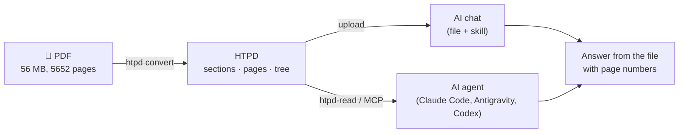

<div align="center">

# HTPD

### Hyper Text Portable Document

**Turn long PDFs into documents that AI models read fast, answer from exactly, and cite by page.**


[What it is](#what-is-htpd) ·
[Quick start](#quick-start) ·
[Use it with your AI](#use-it-with-your-ai) ·
[The format](#the-format) ·
[Results](#results) ·
[Roadmap](#roadmap)

</div>

---

## What is HTPD?

You have a 300-page datasheet or a 5000-page reference manual and a question
about it. You upload the PDF to an AI, and it answers slowly, misses details,
mixes up tables, cannot tell you the page - or invents an answer that is not
in the document at all.

**HTPD fixes the input instead of the model.** It has two parts:

| | Part | What it does |
|---|---|---|
| **A** | **Converter** (`htpd`, C++) | Turns a PDF into HTPD: the exact text, cut into sections at the document's own headings, every paragraph with its page, tables kept as rows, code kept as code, headers and footers removed. |
| **B** | **Reader** (`htpd-read`, skill, MCP server, Python) | Lets any AI use an HTPD document: it finds the few sections that answer a question and hands over only that text - with pages - or says **"Not found in this file."** |



**Principles**

- **Nothing is made up.** The text is word for word what the PDF says. Nothing is summarised or rewritten.
- **Every fact has a page.** Each paragraph carries its page, and the file names the PDF it came from (with its SHA-256).
- **"Not found" is an answer.** A question the document cannot answer gets *"Not found in this file"*, not a guess.
- **Local, free and light.** Runs on a normal PC, offline, with no GPU and no cloud service. The core needs no AI model at all.

---

## Quick start

**Requirements:** Linux (tested on Ubuntu 24.04, also in WSL), g++ 13+, make or CMake, Python 3.10+.

```sh
git clone https://github.com/narendrachampaneri/htpd.git
cd htpd

./scripts/get_pdfium.sh        # downloads the PDF engine once (PDFium, about 4 MB)
make                           # builds build/htpd
make test                      # optional: the C++ tests
```

**Convert a PDF**

```sh
./build/htpd convert manual.pdf --single     # one file: manual.htpd  (for AI chats)
./build/htpd convert manual.pdf              # a folder: manual.htpd/ (for tools and agents)
```

**Ask a question from the command line**

```sh
python3 -m pip install -e .                  # installs htpd-read and htpd-mcp

htpd-read ask IMX93AEC.htpd "What is the maximum NPU frequency?"
```

```
[page 18, 4.1.5 Maximum frequency of main modules]
  EdgeLock® Secure Enclave | 133 MHz | 200 MHz | 250 MHz
  NPU | 500 MHz | 800 MHz | 1000 MHz
[page 18, 4.1.5 Maximum frequency of main modules]
  Maximum frequency of main modules[1]
...
```

Each answer line is copied word for word from the file, with its page and
section; `--context` adds the whole sections for the AI to read.

```sh
htpd-read ask IMX93AEC.htpd "How many PCIe lanes are there?"
```

```
Not found in this file. (the file never mentions PCIe)
```

---

## Use it with your AI

### 1. Any AI chat - just upload the file

`htpd convert manual.pdf --single` writes **one `.htpd` file**. It begins
with the reading rules for the model - *answer only from this file, give the
page of every fact, say "Not found in this file." when the answer is not
there* - followed by the contents and every section with its pages.

Upload it to Claude, ChatGPT or any other assistant instead of the PDF.
If an app does not accept the extension, rename it to `manual.htpd.txt` -
it is plain text.

> Best for documents that fit in the chat's context (a datasheet of a few
> hundred pages). For very large manuals, use the skill below.

### 2. Apps with skills - the `htpd` skill

```sh
python3 scripts/build_skill.py               # writes dist/htpd-skill.zip
```

| App | How to add it |
|---|---|
| **Claude app** | *Customize → Skills*, upload `htpd-skill.zip`, switch it on (code execution must be on). Then upload a `.htpd` file to a chat and ask. |
| **Claude Code** | Unzip into `~/.claude/skills/` (gives `~/.claude/skills/htpd/`). |
| **Other agents** that read `SKILL.md` | Unzip into their skills folder. |

The skill runs a small script that needs **only Python** - no packages, no
model. It searches the file, returns the exact lines with `[page, section]`,
and says why when something is not in the file. Because the model reads only
what the script returns, this also works for manuals far too large for any
chat.

### 3. Agents with MCP - the `htpd-mcp` server

```sh
claude mcp add htpd -- htpd-mcp --bundles ~/manuals        # Claude Code
```

For Antigravity, Codex or any MCP client: command `htpd-mcp`, arguments
`--bundles /path/to/your/htpd/files`. Tools: `list_bundles`, `contents`,
`open_section`, `search`, `ask`, `check`. Standard library only.

---

## The format

An HTPD document is plain UTF-8 text: Markdown with a few fields. Any
model, editor or `grep` can read it. A section in the single file:

````markdown
<!-- htpd section {"n":14,"id":"sections/0014-4-1-5-maximum-frequency-of-main-modules","number":"4.1.5","level":3,"pages":[18,18,18],"parent":"sections/0008-4-1-chip-level-conditions"} -->
## [S14] 4.1.5 Maximum frequency of main modules

Path: 4 Electrical characteristics > 4.1 Chip-level conditions > 4.1.5 Maximum frequency of main modules - page 18

<!-- page 18 -->

```text
Cortex®-A55 cores | 0.9 GHz | 1.4 GHz | 1.7 GHz
DRAM | 933 MHz | 1400 MHz | 1866 MHz
NPU | 500 MHz | 800 MHz | 1000 MHz
```
````

- **Sections** follow the document's own headings (bookmarks, numbered headings, font sizes) and form a tree: parent, children, previous, next.
- **Page marks** `<!-- page N -->` stand above the text of every page.
- **Tables** are rows with ` | ` between cells; **code and listings** keep their spacing.
- **Two forms, same content:** a single `.htpd` file (for chats) and a bundle folder with one file per section (for tools), which is also a valid [Open Knowledge Format](https://github.com/GoogleCloudPlatform/knowledge-catalog/blob/main/okf/SPEC.md) bundle.

The full specification - every field and every rule - is in
[`docs/FORMAT.md`](docs/FORMAT.md). Examples:
[`examples/single-file/sample.htpd`](examples/single-file/sample.htpd) and
[`examples/sample.htpd/`](examples/sample.htpd/).

---

## Results

Measured with the converter on real public documents:

| Document | Pages | Sections | PDF → `.htpd` | Time |
|---|---:|---:|---|---:|
| NXP i.MX 93 Automotive Data Sheet | 109 | 109 | 1.7 MB → 235 KB | 0.35 s |
| NXP i.MX 93 Reference Manual | 5 652 | 5 641 | 56.3 MB → 11.6 MB | 14 s |
| RISC-V Debug Specification | 119 | 164 | – | 0.3 s |
| Arm AAPCS64 | 65 | 125 | – | 0.2 s |
| RISC-V Instruction Set Manual | 906 | 1 015 | – | 2.6 s |

The two i.MX 93 documents were converted to the single file on a 2-core
cloud machine; the other three, to bundle folders, with version 0.1.0.

**Robustness.** A stress test makes 34 difficult PDFs locally - two
columns, sideways tables, rotated pages, 1500 pages, huge tables, CJK and
Unicode text, encrypted, truncated and corrupted files, LaTeX and Word
exports - and checks that the converter never crashes or hangs, that every
bundle is valid, and that no word is lost compared with `pdftotext`. Earlier
versions were also run on 301 damaged PDFs from PDFium's test collection.

**Tests.** 70 C++ tests and 129 Python tests, run on every change. The
Python tests also run without PyYAML, as the skill does in a chat sandbox.

**Answering.** A first check on the i.MX 93 data sheet: of 12 questions
with known answers the right section came first for 7, and both questions
about things the data sheet does not contain (PCIe, HDMI) were answered
*"Not found in this file."* Proper numbers on public test sets come from the
evaluation harness in [`eval/`](eval/) - see the roadmap.

---

## Roadmap

HTPD is version 0.1. It works today; these are the known next steps.

- [x] Converter: sections, pages, tables, code, headers/footers, sideways pages, damaged files
- [x] Single-file `.htpd` with reading rules for AI models
- [x] Reader, word search, "not found" rule, `ask`, MCP server, skill for AI apps
- [ ] **Better search on very large manuals** - a saved index next to the file (today each question re-indexes, about 7 s on 5600 pages) and better ranking for register and table questions
- [ ] Optional meaning search (small open embedding model, CPU only) - measured, then kept only if it helps
- [ ] Evaluation on public test sets, with the numbers in `eval/report.md`
- [ ] OCR for scanned pages (Tesseract, local)
- [ ] Windows build

**Known limits:** no pictures or figures; formulas lose their layout;
scanned pages have no text yet; tables are rows of text (cells spanning
several lines are not joined); tested mainly with English technical
documents. Details: [`docs/CONVERTER.md`](docs/CONVERTER.md#limits-please-read).

---

## Project layout

```
include/ src/ cli/      the converter (C++23, PDFium is used in one file only)
reader/htpd_reader/     the reader: bundle, check, search, retriever, packer, ask, MCP server
skills/htpd/            the skill for AI apps (scripts/build_skill.py packs it)
eval/                   evaluation harness, baselines, report
model/                  training data and the optional decider model
tests/                  C++ tests, test PDFs, the stress test
docs/                   FORMAT.md · CONVERTER.md · PART-B.md · BACKGROUND.md
examples/               a converted document in both forms
```

| Document | For |
|---|---|
| [`docs/FORMAT.md`](docs/FORMAT.md) | The format: anyone can write a reader from it |
| [`docs/CONVERTER.md`](docs/CONVERTER.md) | Building, options, how the converter works, what was tested, limits |
| [`reader/README.md`](reader/README.md) | The reader, its commands and its Python API |
| [`docs/PART-B.md`](docs/PART-B.md) | The plan and measures for the reader |
| [`docs/BACKGROUND.md`](docs/BACKGROUND.md) | Why HTPD is built the way it is |
| [`AGENTS.md`](AGENTS.md) | Rules for contributors and coding agents |

---

## Contributing

Issues and pull requests are welcome. Before you change anything, read
[`AGENTS.md`](AGENTS.md); the short version:

- All tests pass before a change is merged: `make test` and `python3 -m pytest`.
- Every new rule in the code comes with a test that fails without it.
- Never lose text and never make text up.
- A change to what is written into an HTPD file updates `docs/FORMAT.md` in the same commit.

## License

No license has been chosen for HTPD yet, so for now all rights are reserved
by the author. PDFium, which the converter uses, has its own license
(BSD-style with an Apache-2.0 part); after `scripts/get_pdfium.sh` its
license texts are in `third_party/pdfium/licenses/`.

---

<div align="center">

Made by **Narendra Champaneri**

</div>
