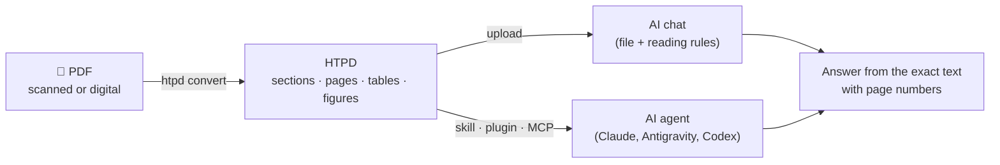

<p align="center">
  
</p>

<p align="center">
  <a href="https://github.com/narendrachampaneri/htpd/releases/latest"></a>
  <a href="https://pypi.org/project/htpd-reader/"></a>
  <a href="https://registry.modelcontextprotocol.io/v0.1/servers?search=io.github.narendrachampaneri/htpd"></a>
  <a href="https://github.com/narendrachampaneri/htpd/actions/workflows/tests.yml"></a>
  
</p>

<p align="center">
  <b>Turn long PDFs into documents AI reads correctly - exact text, every answer with its page.</b>
</p>

<p align="center">
  <a href="https://htpd-studio.ai.studio/"></a>
  &nbsp;
  <a href="https://github.com/narendrachampaneri/htpd/releases/latest"></a>
</p>

<p align="center">
  <a href="#in-plain-words"><b>In plain words</b></a> &nbsp;·&nbsp;
  <a href="#see-it-work"><b>See it work</b></a> &nbsp;·&nbsp;
  <a href="#install-in-one-minute"><b>Install</b></a> &nbsp;·&nbsp;
  <a href="#use-it-with-your-ai"><b>Use with your AI</b></a> &nbsp;·&nbsp;
  <a href="#for-developers"><b>For developers</b></a> &nbsp;·&nbsp;
  <a href="#quality"><b>Quality</b></a> &nbsp;·&nbsp;
  <a href="#roadmap"><b>Roadmap</b></a>
</p>

<p align="center">
  
</p>

---

## In plain words

You have a long PDF - a 300-page datasheet, a 5000-page reference manual, a
policy, a report - and a question about it. Given the whole PDF, an AI often
answers slowly, misses details, mixes up tables and cannot show where its
answer comes from.

**HTPD prepares the document for the AI.** The converter turns the PDF into
one `.htpd` file: the same text, word for word, cut into the document's own
chapters and sections, with the page of every paragraph, the tables as rows,
and the figures as pictures. The AI then reads only the few sections a
question needs and answers from the exact text - with the page, so you can
check it.

<p align="center">
  
</p>

| What you get | What it means for you |
|---|---|
| **Exact text** | Values, part numbers and register names exactly as in the PDF. Nothing is summarised or rewritten. |
| **A page for every fact** | Every answer can be checked in the original document in seconds. |
| **Honest answers** | When the document does not hold the answer, HTPD says so instead of guessing. |
| **Tables and figures** | Tables stay rows with their columns; diagrams and photos are kept as pictures with their caption. |
| **Scanned pages too** | Text in scans and pictures is read by OCR (free Tesseract), marked so you know. |
| **Private and free** | Runs on your own computer. No GPU, no account, no cloud. Open source. |

**Try it in the browser:** [**HTPD Studio**](https://htpd-studio.ai.studio/).

---

## See it work

Real commands and their output on a public 109-page data sheet (NXP i.MX 93, shortened where long).

**1. Convert the PDF once** - about a second for 100 pages:

<p align="center">
  
</p>

**2. Ask in your own words** - the exact line from the document, with its page and section:

<p align="center">
  
</p>

**3. Figures stay pictures** - an AI that can see images looks at the diagram itself:

<p align="center">
  
</p>

In daily use you do not type these commands: you give the `.htpd` file to
your AI, or let the plugin, the skill or the MCP server do it for you.

---

## Install in one minute

| You use | Do this |
|---|---|
| **Claude Code** | `/plugin marketplace add narendrachampaneri/htpd` then `/plugin install htpd@htpd` - converts PDFs and answers from them; the MCP server is included |
| **Claude app** and other apps with skills | Add [`htpd-skill.zip`](https://github.com/narendrachampaneri/htpd/releases/latest) under *Customize → Skills* |
| **Any MCP client** (Antigravity, Codex, Cursor, ...) | `pip install htpd-reader`, then the command `htpd-mcp --bundles <folder>` - or find `io.github.narendrachampaneri/htpd` in the MCP registry |
| **ChatGPT, Gemini** | Upload the `.htpd` file, or make a custom GPT / Gem with the [ready instructions](https://github.com/narendrachampaneri/htpd/blob/main/docs/AI-APPS.md) |
| **The converter** (PDF → `.htpd`) | [Download](https://github.com/narendrachampaneri/htpd/releases/latest) `htpd-0.1.2-linux-x64.tar.gz` (Linux, Windows with WSL) and run `./htpd convert manual.pdf --single` |

The converter and the reader run on your computer. What reaches an AI is
only the text you give it.

---

## Use it with your AI

<details open>
<summary><b>Any AI chat - just upload the file</b></summary>

<br>

`htpd convert manual.pdf --single` writes **one `.htpd` file**. It begins
with the reading rules for the model - *answer only from this file, give the
page of every fact, say so when the answer is not there* - then the contents
and every section with its pages.

Upload it to Claude, ChatGPT, Gemini or any other assistant instead of the
PDF. If an app does not accept the extension, rename it to
`manual.htpd.txt` - it is plain text. For a ChatGPT custom GPT or a Gemini
Gem that always has your document, see
[`docs/AI-APPS.md`](https://github.com/narendrachampaneri/htpd/blob/main/docs/AI-APPS.md)
(instructions ready to paste).

Best for documents that fit in the chat (a datasheet of a few hundred
pages). For very large manuals use the skill, the plugin or MCP below.

</details>

<details>
<summary><b>Claude app and apps with skills - the <code>htpd</code> skill</b></summary>

<br>

| App | How to add it |
|---|---|
| **Claude app** | *Customize → Skills*, upload `htpd-skill.zip`, switch it on (code execution must be on). Then upload a `.htpd` file to a chat and ask. |
| **Claude Code** | Install the plugin (below), or unzip into `~/.claude/skills/`. |
| **Other agents** that read `SKILL.md` | Unzip into their skills folder. |

The skill runs a small script that needs **only Python** - no packages, no
model. It finds the right sections and returns the exact lines with
`[page, section]`. Because the AI reads only what the script returns, this
works even for manuals of thousands of pages.

</details>

<details>
<summary><b>Claude Code - the <code>htpd</code> plugin</b></summary>

<br>

```
/plugin marketplace add narendrachampaneri/htpd
/plugin install htpd@htpd
```

Then ask in plain words - *"convert datasheet.pdf to htpd"*, *"what is the
maximum NPU frequency in datasheet.htpd?"* - or run `/htpd:convert
datasheet.pdf --single`. The first conversion downloads the released
converter once (Linux and WSL, about 4 MB, checked by SHA-256). The PDF
never leaves the computer.

</details>

<details>
<summary><b>Agents with MCP - the <code>htpd-mcp</code> server</b></summary>

<br>

```sh
pip install htpd-reader                                   # htpd-read and htpd-mcp, nothing else needed
claude mcp add htpd -- htpd-mcp --bundles ~/manuals       # Claude Code
```

For Antigravity, Codex, Cursor or any MCP client: command `htpd-mcp`,
arguments `--bundles /path/to/your/htpd/files`. The server is also listed in
the official MCP registry as `io.github.narendrachampaneri/htpd` (clients
start it with `uvx htpd-reader`). Tools: `list_bundles`, `contents`,
`open_section`, `search`, `ask`, `figure` (the picture of a figure, as an
image), `check`.

</details>

---

## For developers

### How it works



| Part | What it does |
|---|---|
| **Converter** `htpd` (C++23, PDFium) | Reads every character with its position and font, removes headers and footers, finds the headings (bookmarks, a printed table of contents, numbering, font size), cuts the text into sections, keeps tables as rows and code as code, stores figures as PNG with their caption, reads scans with OCR. |
| **Reader** `htpd-read` (Python, standard library only) | Finds the sections that answer a question (word search, the tree of titles, a small trained re-ranker), packs only that text with its pages, picks the exact answer lines, and says when the file cannot answer. Also as a skill, a plugin and an MCP server. |

<p align="center">
  
</p>

### Quick start

**Download** (no build needed) from the [release page](https://github.com/narendrachampaneri/htpd/releases/latest):

```sh
tar xzf htpd-0.1.2-linux-x64.tar.gz
cd htpd-0.1.2-linux-x64
./htpd convert manual.pdf --single           # writes manual.htpd
sudo apt install tesseract-ocr               # optional: read scanned pages too
```

**Build from source** - Linux (Ubuntu 24.04, also WSL), g++ 13+, make or CMake, Python 3.10+:

```sh
git clone https://github.com/narendrachampaneri/htpd.git && cd htpd
./scripts/get_pdfium.sh        # the PDF engine, once (about 4 MB)
make                           # builds build/htpd
make test                      # the C++ tests
```

**Convert and ask:**

```sh
./build/htpd convert manual.pdf --single     # one file: manual.htpd  (for AI chats)
./build/htpd convert manual.pdf              # a folder: manual.htpd/ (for tools and agents)

pip install htpd-reader                      # or: python3 -m pip install -e .
htpd-read ask examples/single-file/sample.htpd "What is the maximum bus voltage?"
```

```
[page 2, 2.1.1 Limits]
  Parameter | Min | Typ | Max | Unit
  Bus voltage | 200 | 400 | 480 | V
```

Every answer line is copied word for word from the file; `--context` adds
the whole sections for the AI. More commands: `contents`, `section`,
`search`, `figure`, `check` - see
[`reader/README.md`](https://github.com/narendrachampaneri/htpd/blob/main/reader/README.md).

### The format

An HTPD document is plain UTF-8 text: Markdown with a few fields. Any model,
editor or `grep` can read it.

<details>
<summary><b>One section of an HTPD file</b> (shortened)</summary>

````markdown
<!-- htpd section {"n":14,"id":"sections/0014-4-1-5-maximum-frequency-of-main-modules","number":"4.1.5","level":3,"pages":[18,18,18],"parent":"sections/0008-4-1-chip-level-conditions"} -->
## [S14] 4.1.5 Maximum frequency of main modules

Path: 4 Electrical characteristics > 4.1 Chip-level conditions > 4.1.5 Maximum frequency of main modules - page 18

<!-- page 18 -->

```text
Cortex®-A55 cores | 0.9 GHz | 1.4 GHz | 1.7 GHz
DRAM | 933 MHz | 1400 MHz | 1866 MHz
NPU | 500 MHz | 800 MHz | 1000 MHz
```
````

</details>

- **Sections** follow the document's own headings and form a tree: parent, children, previous, next.
- **Page marks** `<!-- page N -->` stand above the text of every page.
- **Tables** are rows with ` | ` between cells; **code and listings** keep their spacing.
- **Figures** are PNG pictures with caption and page, stored inside the file.
- **Two forms, same content:** a single `.htpd` file (for chats) and a folder with one file per section (for tools), which is also a valid [Open Knowledge Format](https://github.com/GoogleCloudPlatform/knowledge-catalog/blob/main/okf/SPEC.md) bundle.

The full specification is [`docs/FORMAT.md`](https://github.com/narendrachampaneri/htpd/blob/main/docs/FORMAT.md).
Examples: [`examples/single-file/sample.htpd`](https://github.com/narendrachampaneri/htpd/blob/main/examples/single-file/sample.htpd) and
[`examples/sample.htpd/`](https://github.com/narendrachampaneri/htpd/tree/main/examples/sample.htpd).

---

## Quality

**Speed and size** - single file, figures and OCR on, a 2-core cloud machine:

| Document | Pages | Sections | Figures | PDF → `.htpd` | Time |
|---|---:|---:|---:|---|---:|
| NXP i.MX 93 Automotive Data Sheet | 109 | 114 | 53 | 1.7 MB → 2.5 MB | 1.2 s |
| NXP i.MX 93 Reference Manual | 5 652 | 5 929 | 637 | 56.3 MB → 39.8 MB | 67 s |
| RISC-V Debug Specification | 119 | 164 | 3 | 2.4 MB → 0.7 MB | 3.4 s |
| Arm AAPCS64 | 65 | 125 | 5 | 0.4 MB → 0.3 MB | 0.3 s |
| RISC-V Unprivileged ISA | 670 | 760 | 25 | 4.5 MB → 2.8 MB | 4.9 s |

Most of a file with figures is their pictures, at its very end; the text comes first. `--figures off` leaves them out.

**Finding the answer** - 133 test questions about two public manuals ([`eval/report.md`](https://github.com/narendrachampaneri/htpd/blob/main/eval/report.md), written by the evaluation harness):

| | Right section first | Right section in the first 5 | Right page | Answer in the text for the AI |
|---|---:|---:|---:|---:|
| **HTPD reader** | **0.78** | **0.95** | **0.64** | **0.86** |
| Plain word search over HTPD sections | 0.64 | 0.87 | 0.55 | 0.83 |
| Plain word search over 500-token chunks | 0.32 | 0.72 | 0.51 | 0.83 |

The text handed to the AI is about 6 % of the whole document, and the reader
correctly says "not in this file" for 95 % of the questions the manuals do
not answer.

**Many kinds of PDF** - 45 PDFs of known text, made by Word, LaTeX, Chrome,
wkhtmltopdf and slide software, scanned, and with letters drawn as shapes
([`tests/zoo`](https://github.com/narendrachampaneri/htpd/tree/main/tests/zoo)):
99 % of the text in order, 96 % of the headings, 89 % of the table rows exact.

**Robustness** - a stress test of 34 difficult PDFs (two columns, sideways
tables, rotated pages, 1500 pages, encrypted, truncated and corrupted
files): no crash, no hang, every file valid, no word lost. 102 C++ tests
and 155 Python tests run on every change.

---

## Roadmap

HTPD is version 0.1.2. It works today; these are the known next steps.

- [x] Converter: sections, pages, tables, code, headers/footers, sideways pages, damaged files
- [x] Headings from bookmarks, a printed table of contents, numbering and font size; parts of a few pages for documents without headings
- [x] Figures as pictures with caption and page; OCR of scanned pages and text in pictures
- [x] Reader, answer lines, MCP server, skill; a small trained re-ranker ([`model/README.md`](https://github.com/narendrachampaneri/htpd/blob/main/model/README.md))
- [x] Claude Code plugin, `pip install htpd-reader`, MCP registry, instructions for ChatGPT and Gemini, [HTPD Studio](https://htpd-studio.ai.studio/)
- [x] Tested on 45 kinds of PDF of known text
- [ ] Other document types: Word, HTML, plain text, images
- [ ] Questions in the user's own words (a word the document writes differently)
- [ ] Windows build without WSL

**Known limits:** PDF only; what a chart or diagram means is only in its
picture (an AI must look at it); formulas lose their layout; OCR can misread
a number on a scan (check it against the page); tested mainly with English
technical documents. Details: [`docs/CONVERTER.md`](https://github.com/narendrachampaneri/htpd/blob/main/docs/CONVERTER.md#limits-please-read).

---

## Project layout

<details>
<summary><b>Folders and documentation</b></summary>

```
include/ src/ cli/      the converter (C++23, PDFium is used in one file only)
reader/htpd_reader/     the reader: bundle, check, search, retriever, re-ranker, packer, answer, MCP server
skills/htpd/            the skill for AI apps (scripts/build_skill.py packs it)
skills/convert/         the plugin's skill that converts PDFs
.claude-plugin/         the Claude Code plugin and its marketplace (this repository is both)
eval/                   evaluation harness, baselines, report
model/                  the training of the re-ranker
tests/                  C++ tests, test PDFs, the stress test, the document zoo
docs/                   FORMAT.md · CONVERTER.md · READER.md · AI-APPS.md · BACKGROUND.md
examples/               a converted document in both forms
```

| Document | For |
|---|---|
| [`docs/FORMAT.md`](https://github.com/narendrachampaneri/htpd/blob/main/docs/FORMAT.md) | The format: anyone can write a reader from it |
| [`docs/CONVERTER.md`](https://github.com/narendrachampaneri/htpd/blob/main/docs/CONVERTER.md) | Building, options, how the converter works, what was tested, limits |
| [`reader/README.md`](https://github.com/narendrachampaneri/htpd/blob/main/reader/README.md) | The reader, its commands and its Python API |
| [`docs/READER.md`](https://github.com/narendrachampaneri/htpd/blob/main/docs/READER.md) | How the reader finds the answer, and how it is measured |
| [`docs/AI-APPS.md`](https://github.com/narendrachampaneri/htpd/blob/main/docs/AI-APPS.md) | ChatGPT custom GPT and Gemini Gem |
| [`docs/BACKGROUND.md`](https://github.com/narendrachampaneri/htpd/blob/main/docs/BACKGROUND.md) | Why HTPD is built the way it is |
| [`AGENTS.md`](https://github.com/narendrachampaneri/htpd/blob/main/AGENTS.md) | Rules for contributors and coding agents |

</details>

## Contributing

Issues and pull requests are welcome. Before you change anything, read
[`AGENTS.md`](https://github.com/narendrachampaneri/htpd/blob/main/AGENTS.md); the short version:

- All tests pass before a change is merged: `make test` and `python3 -m pytest`.
- Every new rule in the code comes with a test that fails without it.
- Never lose text and never make text up.
- A change to what is written into an HTPD file updates `docs/FORMAT.md` in the same commit.

## License

HTPD is open source under the [Apache License 2.0](https://github.com/narendrachampaneri/htpd/blob/main/LICENSE): you may use,
change and share it, also in commercial products, as long as you keep the
copyright and license notices ([`NOTICE`](https://github.com/narendrachampaneri/htpd/blob/main/NOTICE)) and mark what you changed.
The license includes a patent grant from every contributor.

PDFium, which the converter uses, is not part of this repository and has its
own license (BSD-style with an Apache-2.0 part); after
`scripts/get_pdfium.sh` its license texts are in
`third_party/pdfium/licenses/`. If you give the program to others together
with `libpdfium.so`, give them those files too.

---

<div align="center">

Made by **Narendra Champaneri** &nbsp;·&nbsp; [HTPD Studio](https://htpd-studio.ai.studio/) &nbsp;·&nbsp; [Releases](https://github.com/narendrachampaneri/htpd/releases) &nbsp;·&nbsp; [PyPI](https://pypi.org/project/htpd-reader/)

</div>

<!-- mcp-name: io.github.narendrachampaneri/htpd -->
